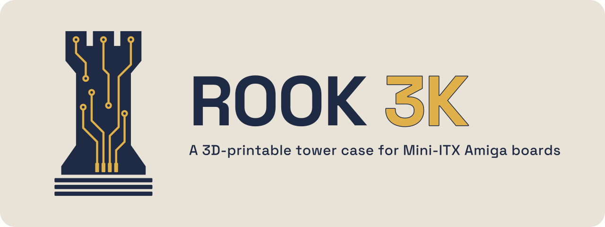
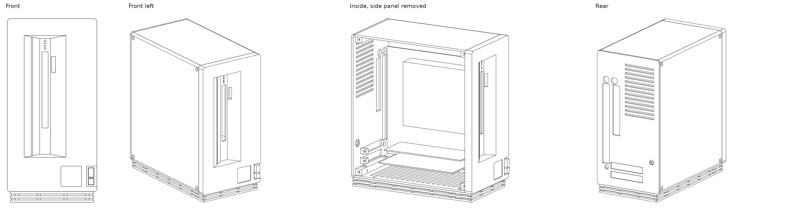
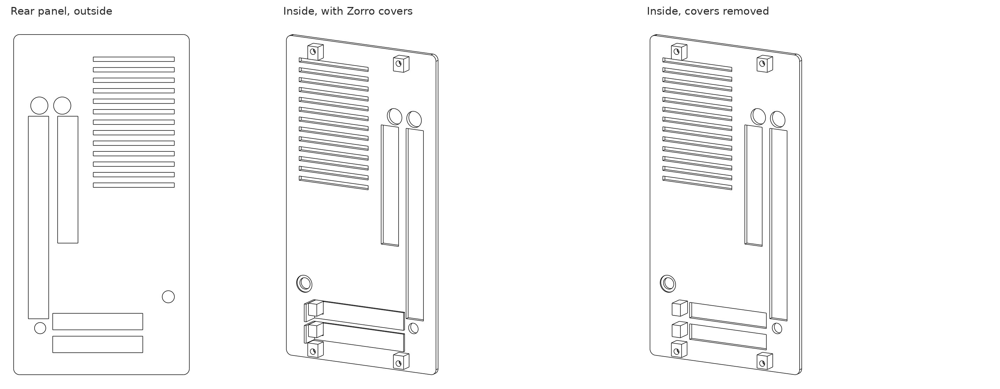
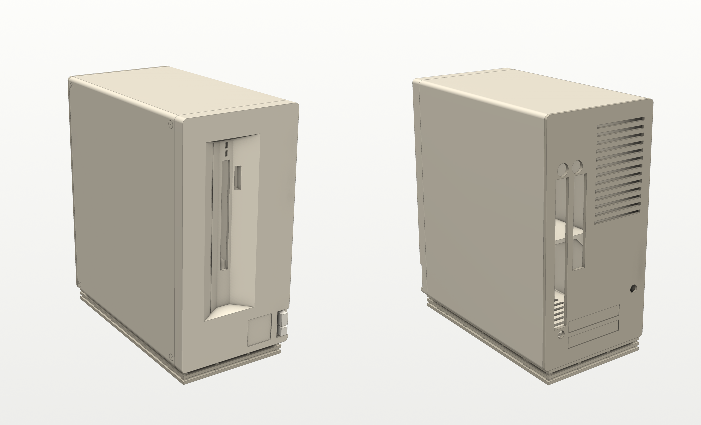

# Rook 3K

A 3D-printable tower case for the Amiga DeniseITX Mini-ITX mainboard.

*Renders of the v0.26 CAD model with the default configuration.*

The design is a tribute to the Commodore Amiga 3000 desktop case and to the Checkmate 1500 Plus case, which is itself a tribute to the same Amiga 3000. The name follows from that: the rook is the tower among the chess pieces, and 3K is 3000.

A small volume has been desirable but never an absolute goal. Aesthetics and the creator's own configuration and preferences have guided the design.

## Status

Work in progress, version 0.26. The U-bracket has been test printed, which verified the switch plate and the mainboard mounting holes, and the floppy mounting holes are verified with the test gauge. A test print of the rear panel verified the I/O cut-outs, the Zorro openings and the DC jack. The recess for the VGA connector was too shallow at first and has been set with a test gauge. That cut-out is optional and off by default. The front panel, the side panel and the foot have not been printed yet. `mainboard=alicia_itx` gives a rear panel for the Alicia 1200. The dimensions have not been verified against an actual Alicia yet. See [CHANGELOG.md](CHANGELOG.md).

## Printing

The case is designed for PLA on a Bambu Lab H2D, which is the printer it has been laid out and sliced for. The Bambu Studio project in the repository root uses the H2D bed.

It should also fit printers with a build volume of about 254 x 254 x 254 mm, such as the common 256 mm class. This has been checked against the part dimensions only, not by printing.

| Part | Footprint on the bed | Height |
|---|---|---|
| U-bracket | 227 x 196 mm | 113 mm |
| Left side panel | 227 x 196 mm | 64 mm |
| Front panel | 227 x 117 mm | 13 mm |
| Rear panel | 227 x 117 mm | 13 mm |
| Foot | 207 x 109 mm | 14 mm |

The longest dimension is 227 mm, which leaves about 13 mm of margin on each side of a 254 mm bed. Things to watch on a smaller printer:

- There is little room for a brim or a skirt around the U-bracket and the side panel. Corner lifting on these large flat parts has to be handled by bed adhesion rather than a wide brim.
- Some printers reserve part of the bed, for example a corner for the purge line or the nozzle wipe. Check that the 227 x 196 mm footprint clears it.
- `src/make_3mf.py` takes the bed size from the template project, so a template saved for the smaller printer gives plates laid out for that bed.

Printers with a bed shorter than 227 mm in both directions cannot print the main parts without splitting them.

## Hardware

Every screw in the case is the same: M3 x 6 with a cylinder head and hex socket (ISO 4762). Each one has 3 mm of material under the head and 3 mm in a heat-set insert. Heads up to 6 mm in diameter fit the counterbores.

| Where | Screws | Inserts |
|---|---|---|
| Front panel to U-bracket, from the inside | 4 | 4, in the front panel |
| Rear panel to U-bracket, from the inside | 4 | 4, in the rear panel |
| Left side panel, from the outside | 4 | 4, in the U-bracket |
| Foot, from the inside | 4 | 4, in the foot |
| Mainboard | 4 | 4, in the U-bracket |
| Floppy drive | 3 | none, into the drive |
| Zorro blanking covers | 2 | 2, in the rear panel |
| SSD, optional | 4 | none, into the drive |

That is 25 screws and 22 inserts for the default configuration. The only screws that show are the four in the left side panel. They sit in counterbores that take a printed plug, held by a small piece of double-sided tape. The hole in the plug is for a needle to lift it out again.

Assembly order matters, because the front and rear panel screws are driven from the inside along the depth of the case. Fit the front panel and the rear panel to the U-bracket before the mainboard goes in. A hex key reaches the screws where a screwdriver does not.

The model is designed for M3 x 3.0 brass heat-set inserts from [CNC Kitchen](https://cnckitchen.com). The insert holes are 4.0 mm in diameter and 4.5 mm deep, with a narrower relief behind the insert for the screw. The `heatinsert_` keys in `config.txt` can be changed to suit other inserts.

The power and reset buttons are intended to press ordinary MX-style mechanical keyboard switches. The two switches snap into a plate in the U-bracket with 14 x 14 mm cut-outs, and the printed buttons sit on the switch stems. Keyboard switches are momentary. The switch plate and the fit of the switches are verified in a test print of the U-bracket, and so are the four mainboard mounting holes. The switch pins point towards the front edge of the mainboard with a few millimetres to spare, so solder the wires to the side of the pins, and clip off the plastic locating pegs on the switch if they are in the way.

The floppy mounting holes in the side panel shelf are verified with the printed test gauge against a Chinon FZ-354 without face plate. Other drives may have the holes at another height, which is set with `floppy_mount_hole_height` in `config.txt`.

## Contents

- `src/rook3k.py` is the parametric CadQuery model. Running it writes the STEP files.
- `src/make_3mf.py` writes a Bambu Studio project with one build plate per part. It needs a `bambu_template.3mf` saved from your own Bambu Studio.
- `config.txt` holds the options that can be changed without editing the model: the mainboard, the case size, floppy drive, buttons, Zorro slots, feet and more.
- `src/render.py` draws the pictures on this page from the model.
- [src/README.md](src/README.md) explains how to run the scripts, which arguments they take and what each option in `config.txt` does.
- `out/` holds the exported STEP files, one per part plus the full assembly, and the renders.
- `rook3k_v0.26.3mf` is the Bambu Studio project for v0.26 with the default configuration, for the Bambu Lab H2D.
- `logo/` holds the logo as SVG: the mark, a lockup with the name, and a badge version for the 25 mm recess in the front panel. The lettering is Space Grotesk, converted to outlines. `rook3k_social_preview.png` is the 1280 x 640 picture used as the social preview of the repository.

## Trivia

The Rook 3K name has three inspirations. Two are superior, beautiful and legendary cases, the Amiga 3000 and the Checkmate 1500 Plus. The third is a game where the number of possible games is close to endless, and where legend has the inventor ask for one grain on the first square of the board, two on the second, four on the third and so on.

The case has a little of the same. As of v0.24, the choice of mainboard, Zorro slots, buttons, LED windows, foot, front styling, badge recess, floppy drive, rear ports and SSD mount gives 57,600 different cases. That is before any change to the height, width and depth, which are free as well.

## Credits

Designed by Arnljot Arntsen. The CAD model was written with Claude Fable 5.2 (Anthropic) as an AI tool, under the designer's direction. All design decisions and all responsibility for the design rest with the designer.

## License

Copyright (C) 2026 Arnljot Arntsen.

This source describes Open Hardware and is licensed under the CERN-OHL-S v2. You may redistribute and modify this source and make products using it under the terms of the CERN-OHL-S v2. The full text is in [LICENSE](LICENSE).

This source is distributed WITHOUT ANY EXPRESS OR IMPLIED WARRANTY, INCLUDING OF MERCHANTABILITY, SATISFACTORY QUALITY AND FITNESS FOR A PARTICULAR PURPOSE. Please see the CERN-OHL-S v2 for applicable conditions.

Source location: https://github.com/arnljot/rook_3k

As per CERN-OHL-S v2 section 4, should you produce hardware based on this source, you must where practicable maintain the source location visible on the product or in its documentation.
