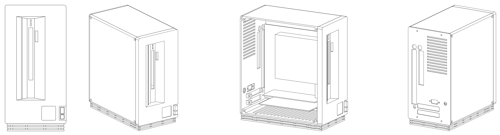
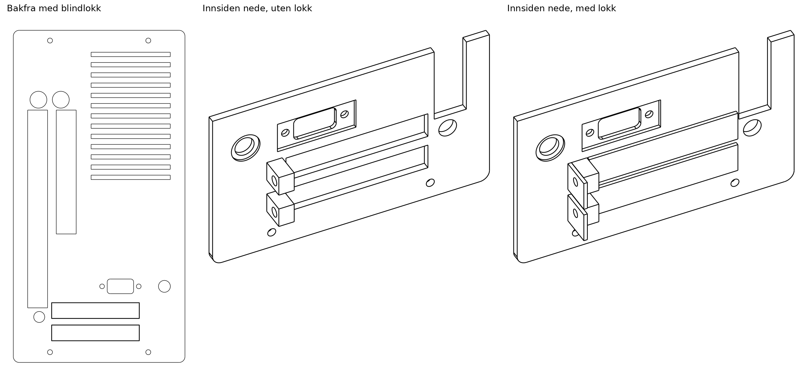

# Rook 3K

A 3D-printable tower case for the Amiga DeniseITX Mini-ITX mainboard.

*Renders of the v0.21 CAD model.*

The design is a tribute to the Commodore Amiga 3000 desktop case and to the Checkmate 1500 Plus case, which is itself a tribute to the same Amiga 3000. The name follows from that: the rook is the tower among the chess pieces, and 3K is 3000.

A small volume has been desirable but never an absolute goal. Aesthetics and the creator's own configuration and preferences have guided the design.

## Status

Work in progress. The parts are modelled but have not been test printed, and several dimensions are still estimates. See [CHANGELOG.md](CHANGELOG.md).

## Printing

The case is designed for PLA on a Bambu Lab H2D, which is the printer it has been laid out and sliced for. The Bambu Studio project in the repository root uses the H2D bed.

It should also fit printers with a build volume of about 254 x 254 x 254 mm, such as the common 256 mm class. This has been checked against the part dimensions only, not by printing.

| Part | Footprint on the bed | Height |
|---|---|---|
| U-bracket | 227 x 195 mm | 113 mm |
| Left side panel | 227 x 195 mm | 64 mm |
| Front panel | 227 x 117 mm | 13 mm |
| Rear panel | 227 x 117 mm | 13 mm |
| Foot | 206 x 109 mm | 14 mm |

The longest dimension is 227 mm, which leaves about 13 mm of margin on each side of a 254 mm bed. Things to watch on a smaller printer:

- There is little room for a brim or a skirt around the U-bracket and the side panel. Corner lifting on these large flat parts has to be handled by bed adhesion rather than a wide brim.
- Some printers reserve part of the bed, for example a corner for the purge line or the nozzle wipe. Check that the 227 x 195 mm footprint clears it.
- `src/make_3mf.py` takes the bed size from the template project, so a template saved for the smaller printer gives plates laid out for that bed.

Printers with a bed shorter than 227 mm in both directions cannot print the main parts without splitting them.

## Hardware

The model is designed for M3 x 3.0 brass heat-set inserts from [CNC Kitchen](https://cnckitchen.com). The insert holes are 4.0 mm in diameter and 4.5 mm deep, with a narrower relief behind the insert for the screw. The `heatinsert_` keys in `config.txt` can be changed to suit other inserts.

The power and reset buttons are intended to press ordinary MX-style mechanical keyboard switches. The two switches snap into a plate in the U-bracket with 14 x 14 mm cut-outs, and the printed buttons sit on the switch stems. Keyboard switches are momentary. The switch dimensions in the model are taken from the common MX footprint and have not yet been checked against a fitted switch.

The floppy mounting holes in the side panel shelf are verified with the printed test gauge against a Chinon FZ-354 without face plate. Other drives may have the holes at another height, which is set with `floppy_mount_hole_height` in `config.txt`.

## Contents

- `src/denise_itx_case.py` is the parametric CadQuery model. Running it writes the STEP files.
- `src/make_3mf.py` writes a Bambu Studio project with one build plate per part. It needs a `bambu_template.3mf` saved from your own Bambu Studio.
- `config.txt` holds the options that can be changed without editing the model, such as the case size and whether there is a floppy drive.
- [src/README.md](src/README.md) explains how to run the scripts, which arguments they take and what each option in `config.txt` does.
- `out/` holds the exported STEP files, one per part plus the full assembly, and the renders.
- `DeniseITX_kabinettv0.21.3mf` is the Bambu Studio project for v0.21.
- `logo/` holds the logo as SVG: the mark, a lockup with the name, and a badge version for the 25 mm recess in the front panel. The lettering is Space Grotesk, converted to outlines.

## Credits

Designed by Arnljot Arntsen. The CAD model was written with Claude Fable 5.2 (Anthropic) as an AI tool, under the designer's direction. All design decisions and all responsibility for the design rest with the designer.

## License

Copyright (C) 2026 Arnljot Arntsen.

This source describes Open Hardware and is licensed under the CERN-OHL-S v2. You may redistribute and modify this source and make products using it under the terms of the CERN-OHL-S v2. The full text is in [LICENSE](LICENSE).

This source is distributed WITHOUT ANY EXPRESS OR IMPLIED WARRANTY, INCLUDING OF MERCHANTABILITY, SATISFACTORY QUALITY AND FITNESS FOR A PARTICULAR PURPOSE. Please see the CERN-OHL-S v2 for applicable conditions.

Source location: https://github.com/arnljot/rook_3k

As per CERN-OHL-S v2 section 4, should you produce hardware based on this source, you must where practicable maintain the source location visible on the product or in its documentation.
